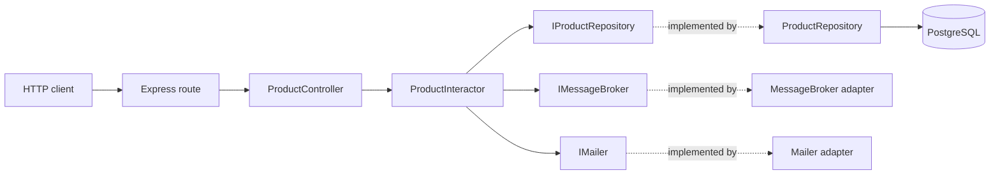
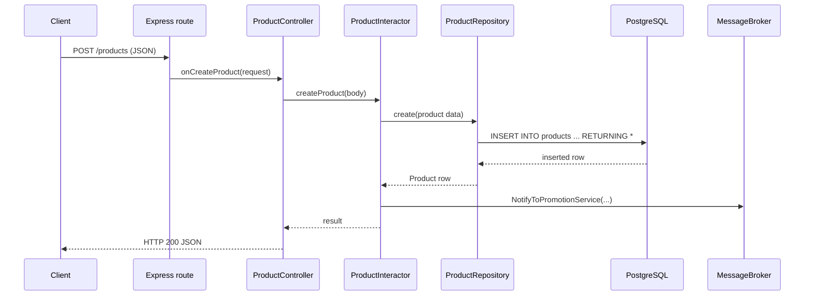
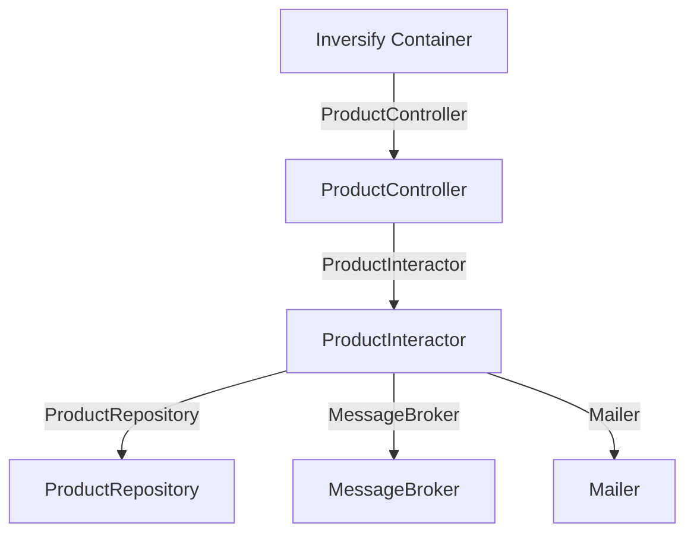
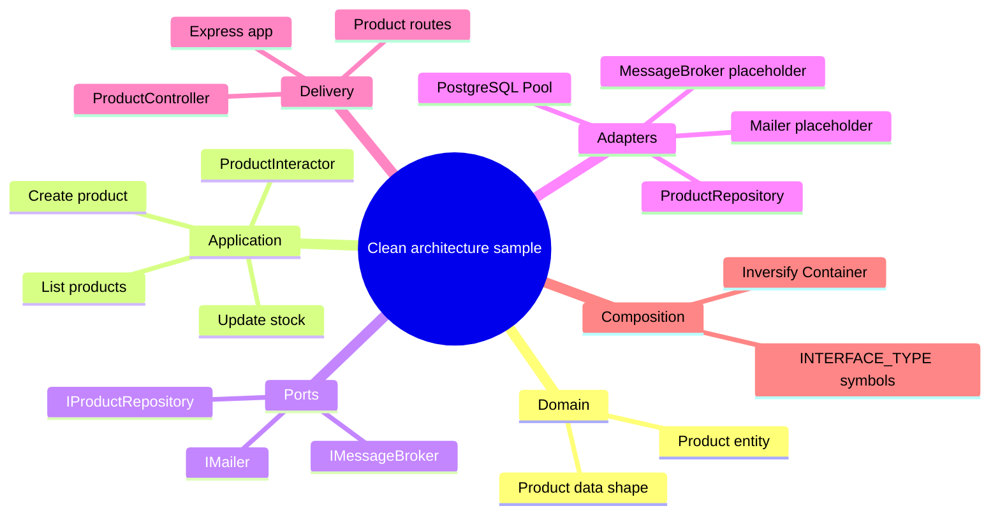

# Node.js Clean Architecture

A small TypeScript and Express product API used to demonstrate a layered, dependency-inverted design. The sample separates HTTP handling, application use cases, persistence, and external service adapters so that each part has a focused responsibility.

> **Project status:** this repository is an architecture example, not a production-ready service. The current startup wiring is inconsistent: `src/index.ts` imports `src/routes/productRoutes.ts`, which imports controller functions that are not exported; class-based controller wiring instead lives in `src/routes/index.ts` and is not mounted by the entry point. The `dev` script also invokes `nodemon`, which is not declared in `package.json`. See [Known gaps](#known-gaps-in-the-current-code).

## Contents

- [Architecture at a glance](#architecture-at-a-glance)
- [Request and dependency maps](#request-and-dependency-maps)
- [Project map](#project-map)
- [Concepts demonstrated](#concepts-demonstrated)
- [Product API](#product-api)
- [Database and local setup](#database-and-local-setup)
- [Known gaps in the current code](#known-gaps-in-the-current-code)

## Architecture at a glance

The intended request path is:



The center of the design contains product behavior and its interfaces. Express, PostgreSQL, and integrations sit at the edges. The repository and integration adapters implement interfaces consumed by the application layer, which keeps business workflow code from having to construct concrete infrastructure classes itself.

## Request and dependency maps

### Create product request



In the current interactor, the promotion notification is a placeholder-style adapter call and is sent with a hard-coded email-like string. The mailer is injected but is not called by the shown product workflows.

### Dependency injection map

`src/routes/index.ts` is the class-based composition root. It maps symbolic keys in `INTERFACE_TYPE` to concrete classes using Inversify:



This is the intended dependency setup in that module. The running app entry point currently imports a different route module; see the status note above and the known gaps below.

### Concept mind map



## Project map

```text
.
├── src/
│   ├── index.ts                      # Express app entry point (currently imports productRoutes)
│   ├── routes/
│   │   ├── index.ts                  # Inversify/class-based route composition
│   │   └── productRoutes.ts          # Older function-style route module
│   ├── controllers/
│   │   └── productController.ts      # HTTP request/response translation
│   ├── interactors/
│   │   └── productInteractor.ts      # Product use-case orchestration
│   ├── entities/
│   │   └── product.ts                # Product entity/data model
│   ├── repositories/
│   │   └── productRepository.ts      # PostgreSQL queries implementing repository port
│   ├── interfaces/
│   │   ├── IProductRepository.ts     # Persistence port
│   │   ├── IproductInteractor.ts     # Use-case contract
│   │   ├── IMailer.ts                # Email adapter port
│   │   └── IMessageBroker.ts         # Message-broker adapter port
│   ├── external-libraries/
│   │   ├── mailer.ts                 # Mailer placeholder adapter
│   │   └── messageBroker.ts          # Message broker placeholder adapter
│   ├── dbConnection.ts               # Lazy PostgreSQL Pool and dotenv loading
│   ├── utils/
│   │   └── appConst.ts                # Inversify symbol keys
│   └── helper.ts                     # Placeholder integration helper functions
├── migrations/
│   ├── 20231227132856-init-tables.js # db-migrate migration wrapper
│   └── sqls/                         # Up/down SQL
├── requests.http                     # Example HTTP requests
├── database.json                     # db-migrate development connection settings
├── docker-compose.yml                # Local PostgreSQL service
├── Makefile                          # Convenience commands
├── package.json                      # Dependencies and dev script
└── tsconfig.json                     # TypeScript compiler options
```

## Concepts demonstrated

### Layered responsibilities

| Part | Responsibility in this project |
| --- | --- |
| Entity | `Product` carries product fields. |
| Interactor / use case | Coordinates create, list, and stock-update workflows. |
| Interface / port | Defines what a use case needs from storage or integrations. |
| Repository / adapter | Implements product storage with parameterized PostgreSQL queries. |
| Controller | Converts Express request data into use-case calls and returns JSON responses. |
| Route | Connects HTTP method and path to a controller method. |
| Composition root | Binds interfaces to concrete classes in the Inversify container. |

### Dependency inversion

The interactor is written against `IProductRepository`, `IMailer`, and `IMessageBroker`, rather than directly constructing the PostgreSQL repository or an external provider client. Inversify resolves those interface tokens to concrete classes in the route composition module. TypeScript interfaces are erased at runtime, so `INTERFACE_TYPE` uses `Symbol.for(...)` values as the container's runtime identifiers.

### Adapter boundaries

`ProductRepository` is the persistence adapter, and `Mailer` and `MessageBroker` are integration adapters. The latter two currently log/return placeholder values; no real email provider or broker client is configured here.

### Separation of HTTP and use cases

The controller parses request parameters, calls the interactor, and writes an HTTP response. The interactor sequences repository and notification operations. Keeping those jobs separate makes each layer easier to replace or exercise independently, though this repository does not currently include tests.

## Product API

The route definitions describe these endpoints:

| Method | Path | Purpose | Example body/query |
| --- | --- | --- | --- |
| `POST` | `/products` | Create a product | `{"name":"iMac","description":"A desktop computer","price":1600,"stock":100}` |
| `GET` | `/products` | List products | Optional `?limit=10&offset=0` |
| `PATCH` | `/products/:id` | Replace product stock | `{"stock":50}` |

Example requests are also in [`requests.http`](requests.http). The create payload uses `description`; the checked-in HTTP example currently says `desc`, which does not match the repository's expected field.

The list controller defaults to limit `10` and offset `0`. The repository applies both values to its SQL query. The current controller's `limit` parsing expression contains an extra `}` in the string it parses, so it will fall back to the default limit even when a query limit is supplied.

## Database and local setup

### Requirements

- Node.js and Yarn
- Docker Compose
- PostgreSQL client tools are optional

The Compose service is PostgreSQL 17, exposed on host port `5432`, with database `clean_architecture` and local development credentials `root` / `root`. The checked-in Compose configuration is intended only for local development.

### Start PostgreSQL

```sh
docker compose up -d
```

Equivalent Make target:

```sh
make start_db
```

### Configure the application connection

`src/dbConnection.ts` reads the following environment variables (the application does not load `database.json` for its runtime pool):

```dotenv
DB_HOST=127.0.0.1
DB_PORT=5432
DB_USER=root
DB_PASSWORD=root
DB_NAME=clean_architecture
PORT=9000
```

Save these values to a local `.env` file before starting the application. Do not use these sample credentials outside local development.

### Apply the schema

The migration creates a `products` table and a name index. `database.json` contains the db-migrate development database settings. The `Makefile` documents `make migrate` (`yarn db-migrate up -e dev`), but `package.json` does not declare the `db-migrate` CLI or provide a migration script. Install/configure the CLI before relying on that command.

### Start the API

The package currently defines `yarn dev`, which runs `nodemon src/index.ts`, but `nodemon` is not declared in the package dependencies. Also resolve the route/controller mismatch described below before expecting the server to start successfully. There is no build, test, or lint script defined in `package.json` at this time.

## Known gaps in the current code

These points describe the checked-in source, not the intended architecture:

1. `src/index.ts` mounts `src/routes/productRoutes.ts`, which imports `CreateProduct`, `GetProducts`, and `UpdateProductStock`; `src/controllers/productController.ts` exports only the `ProductController` class. The imports therefore do not match the controller module.
2. `src/routes/index.ts` has the Inversify class wiring, but `src/index.ts` does not import or mount it. The project currently has two different route composition approaches.
3. `nodemon` and the `db-migrate` command-line tool are not declared in `package.json`, despite being referenced by scripts/Makefile.
4. The controller's limit query parsing includes an extra closing brace, so a supplied limit is ignored.
5. The HTTP example sends `desc`; the entity and repository use `description`.
6. The migration rollback SQL drops `users`, while the forward migration creates `products`.
7. Create and update operations call the promotion adapter with a hard-coded email-like value; the integrations are placeholders, and the injected mailer is unused.
8. Product input and interactor interface types are broad (`any`), and the API currently has no visible validation, error middleware, tests, or health endpoint.

These make the repository useful for exploring architectural boundaries, while also marking the steps needed before treating it as a working service.
